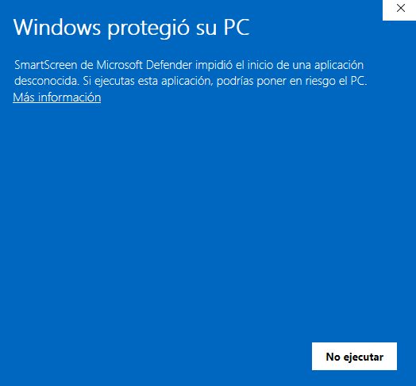
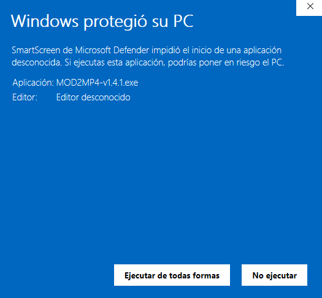
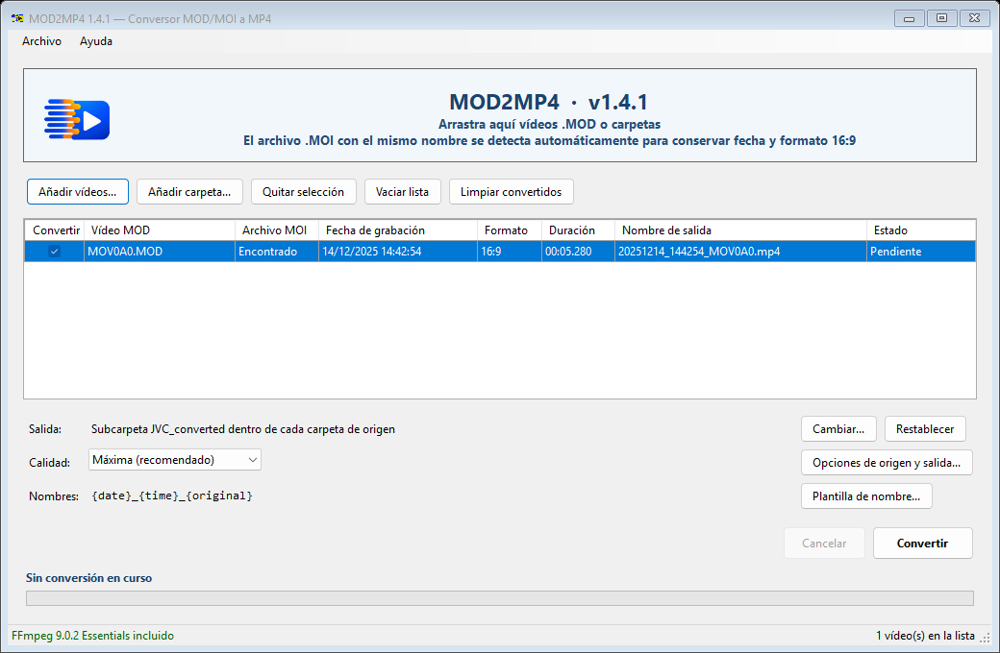
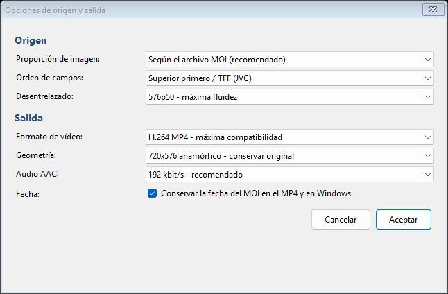
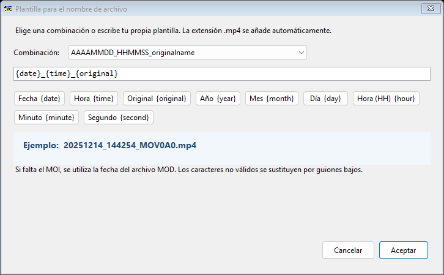
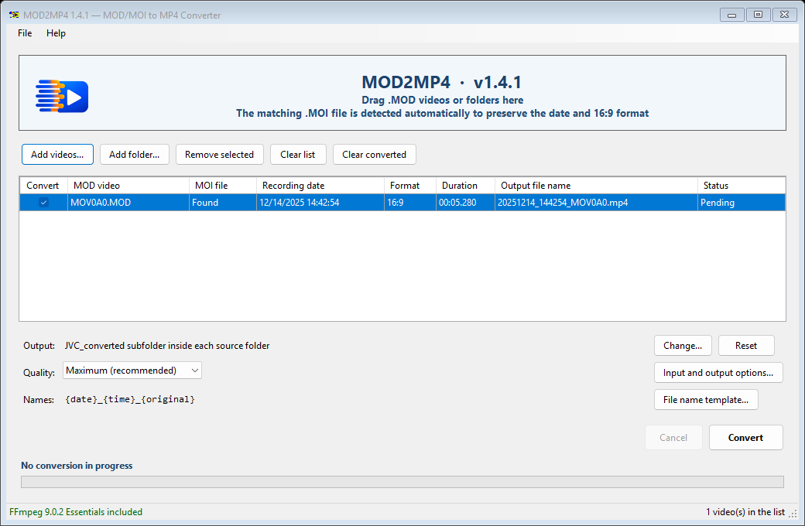
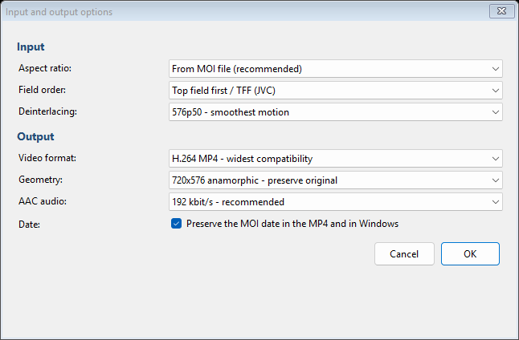
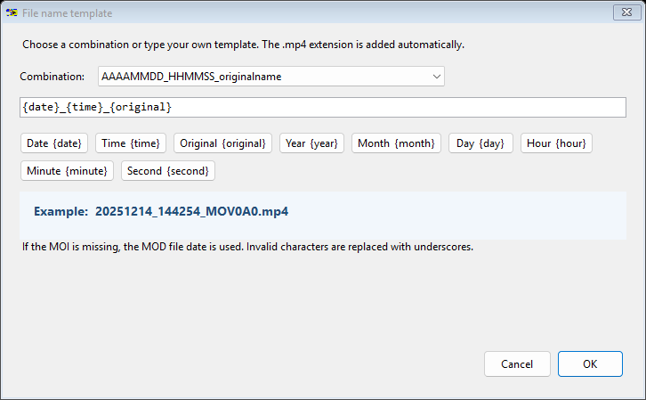

# MOD2MP4

Portable video converter for JVC Everio `.MOD` recordings. Converts legacy SD PAL video to widely compatible MP4 files while preserving recording dates and protecting the original files.

[Español](#español) · [English](#english)

> [!IMPORTANT]
> **MOD2MP4 v1.4.1 Public Beta is available in [GitHub Releases](https://github.com/Hacker0ck/MOD2MP4/releases/tag/v1.4.1).** It is an unsigned 64-bit Windows application; Windows SmartScreen may display a warning. Verify the published SHA-256 before running it.

## Español

### Qué es MOD2MP4

MOD2MP4 es una aplicación portable para Windows que convierte grabaciones JVC Everio SD PAL en formato `.MOD`/`.MOI` a archivos MP4 con vídeo H.264 o H.265 y audio AAC.

- No modifica ni elimina los archivos MOD o MOI originales.
- Lee del archivo MOI la fecha de grabación y la proporción 16:9 o 4:3.
- Si falta el MOI, permite usar la fecha del MOD, elegir otra fecha u omitir el vídeo.
- Desentrelaza mediante BWDIF y puede convertir 576i/25 a 576p/50.
- Conserva la fecha de grabación en el nombre, los metadatos y la fecha del MP4.
- Permite convertir varios archivos y muestra el progreso total y el del vídeo actual.

### Requisitos

- Windows de 64 bits.
- El paquete ZIP portable completo.
- Grabaciones JVC Everio SD PAL en formato MOD/MOI, normalmente MPEG-2 PS, Dolby Digital y 720×576/25i.

El paquete portable incluye **FFmpeg 9.0.2 MOD2MP4**. No es necesario instalar FFmpeg ni añadirlo a las variables de Windows.

### Descarga y puesta en marcha

MOD2MP4 no utiliza instalador:

1. Abre la sección [Releases](https://github.com/Hacker0ck/MOD2MP4/releases).
2. Descarga `MOD2MP4-v1.4.1-public-beta.zip`.
3. Descomprime el ZIP completo en una carpeta. No ejecutes el programa desde dentro del ZIP.
4. Mantén juntos `MOD2MP4-v1.4.1.exe`, `ffmpeg.exe` y `portable.mode`.
5. Abre `MOD2MP4-v1.4.1.exe`.

`portable.mode` hace que el idioma y la plantilla de nombres se guarden en la carpeta local `config`, para que las preferencias viajen con el programa.

### Primer arranque: aviso de Windows SmartScreen

MOD2MP4 todavía no está firmado digitalmente. Por eso Windows puede mostrar el aviso **Windows protegió su PC** aunque Microsoft Defender no haya detectado amenazas en el paquete publicado. Este aviso, por sí solo, no es una detección de malware.

Continúa únicamente si descargaste el ZIP desde la [publicación oficial](https://github.com/Hacker0ck/MOD2MP4/releases/tag/v1.4.1) y la suma SHA-256 coincide con la publicada:

1. Pulsa **Más información**.

   

2. Comprueba que la aplicación indicada es `MOD2MP4-v1.4.1.exe` y pulsa **Ejecutar de todas formas**.

   

No continúes si el archivo procede de otra página o su SHA-256 no coincide.

### Guía visual

**1. Añade los vídeos y comprueba la información detectada.** Puedes arrastrar archivos MOD o carpetas completas directamente a la ventana.



| **2. Revisa las opciones de imagen, desentrelazado, vídeo y audio.** | **3. Comprueba o personaliza el nombre de los MP4.** |
| --- | --- |
|  |  |

**4. Pulsa Convertir.** Los MP4 aparecerán en `JVC_converted` o en la carpeta de salida que hayas elegido. Los originales permanecen intactos.

### Uso rápido

1. Arrastra archivos `.MOD` o carpetas a la ventana, o utiliza los botones para añadirlos.
2. Revisa la proporción, las fechas y los nombres de salida detectados.
3. Elige la carpeta de destino. De forma predeterminada se crea `JVC_converted` dentro de cada carpeta de origen.
4. Selecciona los archivos que quieres procesar y pulsa **Convertir**.
5. Espera a que finalice la conversión. Puedes cancelarla sin borrar los originales.

La plantilla predeterminada genera nombres como:

```text
AAAAMMDD_HHMMSS_nombreoriginal.mp4
```

### Ajustes recomendados

- Proporción: según el archivo MOI.
- Orden de campos: superior primero / TFF.
- Desentrelazado: 576p50.
- Vídeo: H.264 MP4.
- Geometría: 720×576 anamórfico.
- Calidad: máxima.
- Audio: AAC estéreo, 48 kHz, 192 kbit/s.

La conversión puede tardar porque el ajuste recomendado prioriza la calidad sobre la velocidad.

### Compatibilidad actual

La versión 1.4.1 está pensada para grabaciones JVC Everio SD PAL en archivos MOD/MOI. Se ha probado con un clip real JVC Everio MOD+MOI PAL 720×576/25i y con muestras sintéticas 16:9/4:3 en H.264 y H.265. Todavía no están certificados:

- JVC `.TOD`.
- AVCHD y MiniDV.
- MP4 modernos.
- Variantes NTSC.
- Archivos MOD de otras marcas.

### Ayuda y distribución

La aplicación incluye una guía ilustrada en español e inglés desde **Ayuda > Guía de funcionamiento**. Para compartir MOD2MP4, distribuye siempre el ZIP portable completo, no solo el ejecutable.

El paquete incluye los avisos de terceros, la licencia GPL v3, las fuentes correspondientes y la receta de compilación de FFmpeg. Las aportaciones son voluntarias y no desbloquean funciones: [apoyar MOD2MP4 en Ko-fi](https://ko-fi.com/hackerock).

---

## English

### What MOD2MP4 is

MOD2MP4 is a portable Windows application that converts JVC Everio SD PAL `.MOD`/`.MOI` recordings to MP4 files with H.264 or H.265 video and AAC audio.

- It never modifies or deletes the original MOD or MOI files.
- It reads the recording date and 16:9 or 4:3 aspect ratio from the MOI file.
- If the MOI file is missing, it can use the MOD date, a date you choose, or skip the video.
- It deinterlaces with BWDIF and can convert 576i/25 to 576p/50.
- It preserves the recording date in the MP4 name, metadata and file timestamp.
- It processes multiple files and displays both overall and current-video progress.

### Requirements

- 64-bit Windows.
- The complete portable ZIP package.
- JVC Everio SD PAL MOD/MOI recordings, normally MPEG-2 PS with Dolby Digital audio at 720×576/25i.

The portable package includes **FFmpeg 9.0.2 MOD2MP4**. FFmpeg does not need to be installed or added to the Windows environment variables.

### Download and setup

MOD2MP4 does not use an installer:

1. Open the [Releases](https://github.com/Hacker0ck/MOD2MP4/releases) section.
2. Download `MOD2MP4-v1.4.1-public-beta.zip`.
3. Extract the complete ZIP archive to a folder. Do not run the application from inside the ZIP.
4. Keep `MOD2MP4-v1.4.1.exe`, `ffmpeg.exe` and `portable.mode` together.
5. Open `MOD2MP4-v1.4.1.exe`.

`portable.mode` tells MOD2MP4 to store its language and naming-template preferences in the local `config` folder, so the settings travel with the application.

### First launch: Windows SmartScreen warning

MOD2MP4 is not digitally signed yet. Windows may therefore display **Windows protected your PC** even though Microsoft Defender found no threats in the published package. This warning is not, by itself, a malware detection.

Continue only if you downloaded the ZIP from the [official release](https://github.com/Hacker0ck/MOD2MP4/releases/tag/v1.4.1) and its SHA-256 matches the published value:

1. Click **More info** (*Más información* on Spanish Windows).

   

2. Check that the listed application is `MOD2MP4-v1.4.1.exe`, then click **Run anyway** (*Ejecutar de todas formas*).

   

Do not continue if the file came from another website or its SHA-256 does not match.

### Visual guide

**1. Add the videos and check the detected information.** You can drag MOD files or complete folders directly onto the window.



| **2. Review the picture, deinterlacing, video and audio options.** | **3. Check or customise the MP4 file names.** |
| --- | --- |
|  |  |

**4. Click Convert.** The MP4 files will appear in `JVC_converted` or in the output folder you selected. The originals remain untouched.

### Quick start

1. Drag `.MOD` files or folders onto the window, or use the add buttons.
2. Check the detected aspect ratio, dates and output file names.
3. Choose the destination folder. By default, MOD2MP4 creates `JVC_converted` inside each source folder.
4. Select the files to process and click **Convert**.
5. Wait for conversion to finish. You can cancel it without deleting the originals.

The default naming template produces names such as:

```text
YYYYMMDD_HHMMSS_originalname.mp4
```

### Recommended settings

- Aspect ratio: from the MOI file.
- Field order: top field first / TFF.
- Deinterlacing: 576p50.
- Video: H.264 MP4.
- Geometry: anamorphic 720×576.
- Quality: maximum.
- Audio: stereo AAC, 48 kHz, 192 kbit/s.

Conversion can take some time because the recommended preset prioritises quality over speed.

### Current compatibility

Version 1.4.1 is intended for JVC Everio SD PAL MOD/MOI recordings. It has been tested with one real JVC Everio PAL 720×576/25i MOD+MOI clip and synthetic 16:9/4:3 H.264 and H.265 samples. The following formats are not currently certified:

- JVC `.TOD`.
- AVCHD and MiniDV.
- Modern MP4 files.
- NTSC variants.
- MOD files from other brands.

### Help and redistribution

The application includes an illustrated Spanish and English guide under **Help > User guide**. To share MOD2MP4, always distribute the complete portable ZIP package, not only the executable.

The package includes third-party notices, the GPL v3 licence, corresponding sources, and the FFmpeg build recipe. Contributions are voluntary and do not unlock features: [support MOD2MP4 on Ko-fi](https://ko-fi.com/hackerock).
